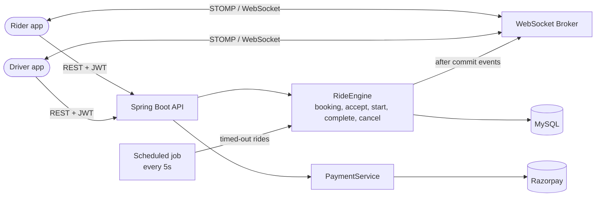
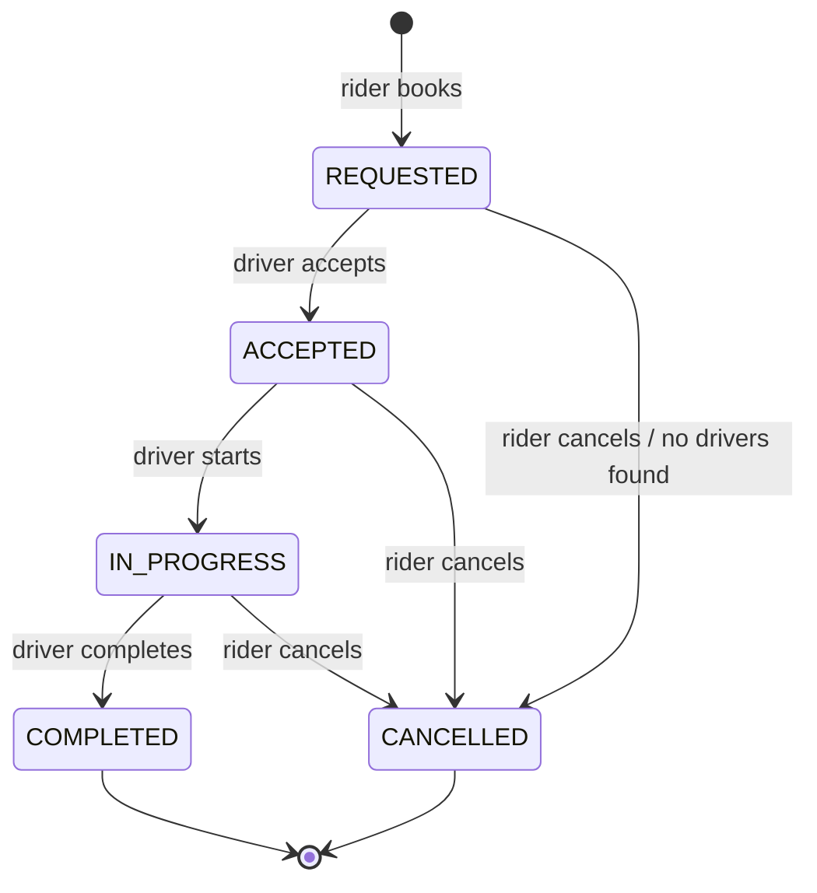

# SafarX: Ride-Hailing Backend

An Uber-style ride-hailing backend built with **Java 21, Spring Boot, Hibernate and MySQL**.
Riders request a ride, nearby drivers are notified in real time over **WebSockets**, and the first driver to accept gets the ride. The project focuses on the hard parts of this problem: **concurrent ride assignment, secure real-time channels, and safe payments**.

> Status: working MVP. See [Limitations & Roadmap](#limitations--roadmap) for what is intentionally not done yet.

---

## Features

- **Authentication:** email/password login (BCrypt) and **Google OAuth2**, both issuing stateless **JWT** tokens
- **Role-based access control:** `RIDER`, `DRIVER`, `ADMIN`, with ownership checks on every ride action
- **Radius-expanding dispatch:** searches 1 km → 10 km in waves, notifying only drivers who were not already notified
- **Real-time updates (STOMP over WebSocket):** ride offers to drivers, status and live driver location to riders
- **Concurrency-safe assignment:** only one driver can win a ride, even if many accept at the same moment
- **Ride lifecycle:** `REQUESTED → ACCEPTED → IN_PROGRESS → COMPLETED` (or `CANCELLED`)
- **Payments:** Razorpay order creation and server-side signature verification
- **Polymorphic fares:** `Car`, `Bike` and `Auto` each implement their own fare calculation
- **Centralised error handling:** consistent JSON errors with correct HTTP status codes

---

## Tech Stack

| Layer | Technology |
|---|---|
| Language / Framework | Java 21, Spring Boot 3.2 |
| Persistence | Spring Data JPA, Hibernate, MySQL |
| Security | Spring Security, JWT (jjwt), Google OAuth2 |
| Real-time | Spring WebSocket (STOMP, SockJS) |
| Payments | Razorpay Java SDK |
| Other | Spring AOP, Bean Validation, Lombok, Maven |

---

## Architecture



Layers: `controller` → `service` (`RideEngine`, `PaymentService`, `UserService`, ...) → `repository`. Notifications are published as Spring events and sent over WebSocket **only after the database transaction commits**.

### Ride lifecycle



---

## Key Design Decisions

### 1. Radius-expanding dispatch
- A ride starts at a 1 km radius. If nobody accepts within **20 seconds**, a scheduled job (runs every 5 s) widens the radius by 1 km, up to **10 km**.
- Drivers who were already notified are stored in a `ride_notified_drivers` table and excluded from later waves, so each wave only reaches *new* drivers.
- Empty radii are skipped instantly (it is a single query); the 20-second wait applies only after drivers have been notified.
- Distance is computed in SQL with the spherical law of cosines (clamped with `LEAST(1.0, ...)` to avoid floating-point `NULL`s).

### 2. Race-condition-safe ride assignment
Several drivers can receive the same ride and accept at the same time. Assignment is protected in layers:
- The ride row is read with a **pessimistic lock** (`SELECT ... FOR UPDATE`) in state-changing methods.
- The ride is claimed with an **atomic conditional update**: `UPDATE rides SET status = 'ACCEPTED', ... WHERE ride_id = ? AND status = 'REQUESTED'`. Exactly one row must be updated, otherwise the driver gets a `409 Conflict`.
- The driver is claimed atomically too: `WHERE status = 'AVAILABLE'`.
- Both claims run in one transaction, so any failure rolls everything back.
- Driver location and status are updated with **targeted queries**, never by saving a stale entity, which avoids lost updates.

### 3. Security
- Stateless JWT authentication; role rules on exact path patterns plus **ownership checks** in the service layer (a rider can only cancel/view their own rides, a driver can only start/complete rides assigned to them).
- Roles cannot be chosen freely by the client. `ADMIN` can only be assigned in the database.
- **WebSocket hardening:**
    - JWT is required on `CONNECT`.
    - Subscriptions are restricted to `^/topic/(ride|driver)/\d+$` (no wildcards).
    - A rider can only subscribe to their own ride, a driver only to their own channel and assigned rides.
    - Clients cannot publish directly to `/topic/**`.
- **OAuth:** the token is returned in the URL fragment (not the query string), and Google sign-in does not silently link to an existing password-based account.
- **Payments:** the Razorpay order is created from the **server-side fare** and saved on the ride; verification checks the signature against the *stored* order id, and the caller must own the ride.

### 4. Reliable notifications
Events (`RideBroadcastEvent`, `RideNotificationEvent`) are delivered with `@TransactionalEventListener(AFTER_COMMIT)`, so a driver or rider is never notified about something that later rolls back.

---

## API Overview

All endpoints except those marked *public* need `Authorization: Bearer <token>`.

| Method | Endpoint | Role | Description |
|---|---|---|---|
| POST | `/api/auth/register` | public | Register a rider account |
| POST | `/api/auth/login` | public | Login, returns a JWT |
| POST | `/api/auth/complete-profile` | any | Create rider/driver profile (one-time role choice) |
| GET | `/oauth2/authorization/google` | public | Start Google login |
| POST | `/api/driver/onboard` | public | Register a driver together with a vehicle |
| POST | `/api/driver/vehicle` | DRIVER | Register a vehicle for an existing driver |
| PATCH | `/api/driver/status?status=` | DRIVER | Go `AVAILABLE` / `OFFLINE` |
| POST | `/api/rides/book` | RIDER | Request a ride |
| PUT | `/api/rides/accept/{id}` | DRIVER | Accept a ride |
| PUT | `/api/rides/start/{id}` | DRIVER | Start a ride |
| PUT | `/api/rides/complete/{id}` | DRIVER | Complete a ride |
| PUT | `/api/rides/cancel/{id}` | RIDER | Cancel a ride |
| GET | `/api/rides/history/{riderId}` | RIDER | Own ride history |
| POST | `/api/payment/create-order` | RIDER | Create a Razorpay order for a completed ride |
| POST | `/api/payment/verify` | RIDER | Verify the payment signature |
| GET | `/api/vehicles/status/{type}` | any | List vehicles by type (`CAR`, `BIKE`, `AUTO`) |
| GET | `/api/rides/all`, DELETE `/api/rides/delete/{id}` | ADMIN | Admin operations |

### WebSocket

- Endpoint: `/ws-ride` (SockJS). Send `Authorization: Bearer <token>` as a STOMP header on `CONNECT`.
- Subscribe: `/topic/driver/{driverId}` (ride offers, timeouts, taken/cancelled events) and `/topic/ride/{rideId}` (status and driver location).
- Send: `/app/update-location` with `{ rideId, latitude, longitude }` (drivers only).

---

## Getting Started

### Prerequisites
- JDK 21
- Maven
- MySQL 8 running locally

### Configuration
Create a database named `SafarX_db` (tables are created by Hibernate on first run), then set these environment variables:

| Variable | Description |
|---|---|
| `DB_USERNAME` | MySQL user (default `root`) |
| `DB_PASSWORD` | MySQL password |
| `JWT_SECRET` | Base64-encoded secret, at least 256 bits |
| `GOOGLE_CLIENT_ID` / `GOOGLE_CLIENT_SECRET` | Google OAuth2 credentials |
| `RAZORPAY_KEY_ID` / `RAZORPAY_KEY_SECRET` | Razorpay test keys |
| `frontend.url` *(optional)* | Frontend origin, default `http://localhost:5173` |

Generate a JWT secret with:
```bash
openssl rand -base64 32
```

### Run
```bash
mvn spring-boot:run
```
The API starts on `http://localhost:8080`.

---

## Limitations & Roadmap

This is an MVP, and these are known next steps:

- **Dispatch:** ranked, sequential offers (instead of broadcasting to all drivers in range) and a bounded total search window
- **Geo search:** move driver locations to **Redis GEO** instead of SQL distance queries
- **Payments:** Razorpay **webhooks** for reliability, and `BigDecimal` for money
- **Testing:** unit and concurrency tests (e.g. two drivers accepting the same ride)
- **Operations:** Docker, Flyway migrations, environment profiles, refresh tokens, rate limiting
- **Upgrade:** latest Spring Boot version

---

## Author

**Himanshu Kumar**: B.Tech CSE, backend-focused developer.
[GitHub](https://github.com/himanshu-singh-java) · [LinkedIn](https://www.linkedin.com/in/himanshu-kumar-sde/)
